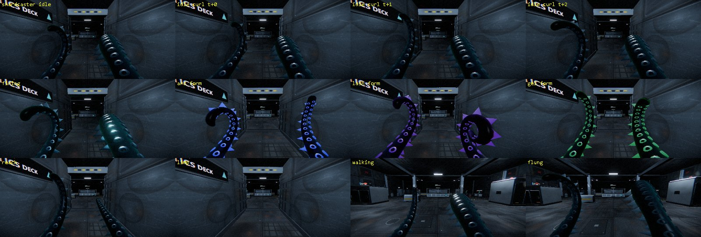

# INTRUDER V2: technical assessment

Status: **awaiting approval.** No V2 story, environment or gameplay work has started. The only changes from V1 so far are the ones that separate the two projects (listed in section 1).

Evidence comes from reading the code and running it. Where something is a judgement or is untested, it says so.

---

## 1. What is in place

| | Location | Verified how |
|---|---|---|
| **V1, untouched** | `Desktop/Intruder-Rebuild`, commit `ab3251c` | Clean tree, same commit, same file hash (`d4060558a5a048d9`) before and after. Live site still on `ab3251c`, with no V2 code in its bundle |
| **Git checkpoint** | Tag `v1-final`, also pushed to GitHub | Points at `ab3251c` |
| **Offline backup** | `Desktop/Intruder-Backups/intruder-v1-ab3251c.bundle` (164 MB), all branches and tags | V2 was cloned from this file and matched V1's commit and file hash exactly, so the backup is proven restorable |
| **Files git ignores** | `Desktop/Intruder-Backups/review-not-in-git` (217 MB) | The screenshot folder, which a git backup would miss |
| **V2** | `Desktop/Intruder-V2`, branch `v2` | Own `node_modules`, own dev server: `npm run dev`, then http://localhost:5174 |

Changes made so V2 cannot affect V1:

- **No deploy.** The GitHub workflow is removed and there is no `origin`. The `v1` remote can only fetch (handy for pulling a V1 fix across); its push address is deliberately invalid.
- **Own saves.** Every storage name is now `intruderv2-*`, including the offline cache, so a V2 save can never overwrite a V1 save even from the same web address.
- **Own art paths.** Two Blender scripts imported their shared tools from V1's folder by absolute path. Now fixed.
- **Own port and label.** Port 5174, and "V2 EXPERIMENT" on the menu and browser tab.

**One shared risk remains:** Blender is a single live session. Before running an art script for V2, check the export path points at `Intruder-V2`.

**V2 regression, run against V2 in realistic mode:** full journey test, film-to-chapter-end test, three facility playthroughs, six boarding walks. All pass, with no errors logged. V2 currently plays exactly like V1.

---

## 2. Reuse: what the code actually supports

### Reuse directly (little or no change)

| System | Files | Why it is safe |
|---|---|---|
| Player movement, jump, ledge climb, dash | `player.js`, `collision.js` | Only 14 references to the rest of the game, 4 of them the ability checks that move to mutations |
| First-person arms | `arm.js`, `viewmodel.js` | Pose is plain numbers per arm. Built to be changed, see section 4 |
| Legs and body seen when looking down | `body.js`, `tentacle.js` | Eight soft arms, table-driven |
| **Security androids** | `android.js`, `enemy.js` | Three variants (trooper, scout, heavy). AI depends only on generic services: player, world, navigation, effects |
| Navigation | `nav.js` | Generic |
| Absorb **animation** | `absorb.js` timeline, `tongues.js` | Tongues, haul, shards, gulp. The *targeting* needs work (below); the animation does not |
| Projectiles, effects, explosive drums, doors | `projectiles.js`, `effects.js`, `barrels.js`, `door.js` | Generic |
| Attack abilities | `arsenal.js`: `arc`, `barb`, `lash`, `gel`; `shardcaster.js` | Each is a self-contained function, called by name. They can become mutation abilities almost as they are |
| Rendering, audio, input, touch | `post.js`, `audio.js`, `soundscape.js`, `input.js`, `touch.js` | Generic |
| Homeworld and its life | `home.js`, `homeLife.js`, `debris.js` | The valley, wildlife and attack are exactly the opening V2 needs |
| **Abduction beam** | `home.js`, `elder.js`, attack in `intro.js` | Already lifts one of your kind, thrashing, into a ship. Swapping elder for child is mostly a retarget and rescale |
| Human models | `humans.js`, `continuityHuman.js` | Rigged, with faces and clothing, with walk and seated poses |
| Art pipeline | `art/modelkit.py`, `build_*.py` | Grime, UVs, export |

### Needs significant rework

| System | Problem | What it needs |
|---|---|---|
| **Absorption targeting** | Only considers `g.enemies` and only when disabled. **Nothing organic can be absorbed at all**: wildlife is drawn as instanced visuals with no individual identity, health or position | A general "absorbable" interface, and a small creature class for individual organic targets |
| **Arsenal vs mutations** | Forms are a fixed list of 5, keyboard-bound, always available once learned, saved permanently | Replace with a data-driven mutation registry (section 4) |
| **Weapon wheel** | `wheel.js` exists but **is not connected to anything**: nothing imports it, and its HTML and CSS no longer exist. It drives an abandoned system (`weapons.js`) of 9 placeholder forms where only one works | Adapt to the mutation registry, restore its HTML and CSS, wire up input. Its logic looks sound but **has not run in a long time; treat as untested** |
| **Run structure** | Death retries the room. Max health is a permanent bonus that survives everything. Forms persist. Layouts use unseeded `Math.random` (15 uses in `procgen.js`), so a run cannot be reproduced | Separate run state from permanent state, add a seeded layout generator, decide what persists (section 7) |
| **Saves** | Two modules (`core/save.js`, `game/progress.js`) manage the same record, plus several standalone keys | Merge into one versioned V2 save |
| **Humans** | Models only, with no behaviour. **Helpful finding:** aiming, projectiles and every attack only ever look at `g.enemies`, so a human cannot be harmed by accident today. "Don't automatically kill humans" is already true by construction | A small non-combat human. `Npc` in `surface.js` (wander, face the player) is a good starting point. The decision scene needs a real choice, which no system has yet |
| **Story layer** | V1 canon is written into 16 files (`intro.js` alone has 46 mentions) | Replace text and beats, not systems. `campaign.js`'s structure (beats, tracker, one place for consequences) is reusable; its content is not |
| **Opening flow** | `intro.js` is 1,612 lines in one class, and other systems use 25 different parts of it | Do not edit in place. Keep it dormant and write a shorter V2 prologue beside it, reusing `home.js` directly |

### Temporarily disable, do not delete

These work, and some may return. A single `src/v2/flags.js` would gate them.

| Feature | Why off for now | Note |
|---|---|---|
| Space flight and ship combat (`flight.js`, `flightCombat.js`) | Not part of the new premise yet | 25 references across 4 files; gate at the entry points |
| Landable worlds and species (`surface.js`, `worlds.glb`) | Same | Self-contained, easy to gate |
| V1 film, trial 27, elder's mark | Story replaced | `opening` stays as an inactive object, because too much refers to it to remove safely |
| Chart room, road to Earth, crossing, voices in jars | V1 story | The *mechanisms* (touch-to-keep, consequences) are worth reusing |
| Drones and crawlers as enemies | Brief says androids are the main enemy | Keep the code. They may return as rarer enemies or as mutation sources |
| Medkits | "Trial feed" is V1 fiction, and healing should probably come from absorbing | Design decision, section 7 |

**Already dead in V1, leave alone for now:** `story.js`, `tentacles.js`, `creature/creator.js`, and `wheel.js` plus `weapons.js` until adapted. Nothing imports them, so they cost nothing but clutter. Tidy them up later, not now.

---

## 3. Conflicts with V1 canon

The new direction contradicts the existing story at its foundations. This matters because V1's rule explains its mechanics, so V2 needs a replacement rule, not only new text.

| V1 | V2 brief | Consequence |
|---|---|---|
| "What we touch, we keep": the whole species can absorb | A dormant ability the protagonist discovers | **V1's explanation for absorbing goes away.** Why this parent? The answer shapes the whole story |
| Vengeance at all costs. "No redemption arc. You never doubt" | Grief, and "the possibility of peace" | Every line of the player character's voice must be rewritten, not edited |
| Elder, 41,000 captives, take Earth | One child, who has died | V2's stakes are far smaller and more personal. That should be a strength, but the road-to-Earth structure does not carry over |
| Crew has left the ship, an AI runs it | Humans are central antagonists | V2 needs humans aboard and visible |
| Starts armed from a pilot's sidearm | An ordinary parent | Starting weapon and early combat need rethinking |

The octopus body is **kept**: you asked for it specifically, and every animation system is built around it.

---

## 4. Visibly changing anatomy and a limited wheel

### The constraint

The game is first person, and the player's body is not drawn from inside it. **A mutation only counts if it can be seen in first person.** That leaves the arms (always on screen), the legs and mantle (looking down), and the shadow on desktop. A full-body view would have to be a staged moment.

### Tested: new body parts can bend with the arm, with no rigging

The arm's suckers are ordinary geometry authored along a straight arm, and the graphics card bends them along with the skin. A throwaway test added spines the same way:



**Result:** the spines stayed attached through idle curl, firing, reach, limp, walking, flinch and three weapon forms, with no rigging and no per-frame CPU work, at 462 triangles for both arms. They picked up each form's colour automatically. That test was not kept. The spines are a proof of technique, not a design: they are sharper than your "soft, no sharp points" direction, and the real mutations should be designed to fit it.

**Still to build:** a grow-in animation (a small shader addition), and giving each mutation its own material instead of sharing the suckers'.

### Five ways to change the body, cheapest first

| Channel | How | Already exists? |
|---|---|---|
| 1. Proportions | Per-arm length, thickness, curl, mouth | Yes: `uLen`, `uThick`, `uCurl`, `uMouth` |
| 2. Skin | Plates, seams and glow creeping from the tip | Yes as one-way `uMachine`. Split into organic and technological |
| 3. Growths | Geometry authored in Blender in arm space, as tested above | **Proven**, needs the pipeline |
| 4. Extra arms | Another instance of the arm class | Partly: the class is reusable, but placement and poses for a third arm are unbuilt and **untested** |
| 5. Legs and mantle | Radius and count from a table; mantle for looking down | Yes for proportions |

### The mutation record: one entry, four jobs

```js
{
  id: 'current-sheath',
  source: 'android',                 // what you absorb to get it
  site: 'right-arm',                 // where it grows; one mutation per site
  anatomy: { mesh: 'Sheath_R', skin: { tech: 0.4 }, arm: { uThick: 1.15 } },
  active: 'arc',                     // existing ability function; appears on the wheel
  passive: { wakesDeadSystems: true }, // a use beyond combat
}
```

A mutation that does not fill in `anatomy` and either `active` or `passive` is not finished. That enforces your requirement that every mutation is visible and functional.

### The limited wheel

**Recommendation: the wheel shows what is on your body. Nothing else.**

- Only as many entries as your body has grown, up to a cap (suggest 3 at first, 4 at most).
- **Each body site holds one mutation.** Absorbing a new one for an occupied site means choosing: keep it, or let the old one be consumed. That is the roguelike decision, and it happens at the moment of absorbing.
- **Looking at your arms tells you your loadout**, so the wheel confirms what you can already see.

This replaces number keys and the slot bar with one coherent system.

---

## 5. Smallest playable prototype

**The question it must answer:** *does evolving your body while hunting for your child feel like one game, and does the final decision land?* Anything that does not help answer that is out.

**Length:** about 15 to 20 minutes per run.

| # | Contents | Mostly reused from |
|---|---|---|
| 1 | **Home.** Your child with you, an ordinary moment, the attack, the child taken. The ability wakes when you absorb something to survive | `home.js`, `homeLife.js`, abduction beam |
| 2 | **A hard cut to the ship.** No flight | New, trivial |
| 3 | **5 or 6 generated rooms, androids only** | `procgen.js`, `encounter.js`, `android.js` |
| 4 | **Exactly 3 mutations**, each with visible anatomy, a combat use and a non-combat use: one organic (absorbed at home), two technological (from androids) | `arsenal.js` abilities, section 4 |
| 5 | **The wheel, capped at 2.** Three mutations and two slots force a real choice | Adapted `wheel.js` |
| 6 | **Death starts a new run** with a new layout, keeping one small thing | Seeded `procgen.js` |
| 7 | **One final room.** Your child's empty cell, and one defenceless human. Two choices, one short outcome each, placeholder writing | `level.js` cell props, `humans.js` |

**Deliberately excluded:** flight, other worlds and species, drones and crawlers, more than one human, branching consequences beyond the end card, final writing, new environments, phone tuning.

**It succeeds if a first-time player can:**
1. Say what happened and what they want within two minutes, unprompted.
2. Tell what they can do just by looking at their arms.
3. Recall a mutation choice they found hard.
4. Pause at the final decision instead of clicking through.

**Build order, each stage tested and playable before the next:**

| Stage | Result |
|---|---|
| **A. Foundations** | Feature flags, one save, run versus permanent state. V2 boots straight into generated rooms |
| **B. Anatomy and mutations** | Registry, grow-in effect, skin channels, three mutations. Androids only |
| **C. Absorb anything, and the wheel** | Organic targets, choose-on-absorb, wheel capped at 2 |
| **D. Roguelike loop** | Seeded runs, death starts a new one, one thing persists |
| **E. Opening** | New short prologue, the child, the abduction |
| **F. Final room** | Empty cell, the human, the decision |

Stages A to D answer "is the evolution fun?" before any story is written, so if that core does not work you find out cheaply. E and F then test whether the story lands.

---

## 6. Main risks

- **Grief is the hardest thing here, and the code cannot prove it.** The tech is largely ready, and that is exactly why it would be easy to end up with a good mutation shooter that merely mentions a dead child. That is why the prototype includes the final room.
- **Roguelike and fixed story pull against each other.** A carefully told story and repeated runs need an answer to "why am I here again?" Section 7, question 2.
- **`game.js` and `intro.js` are tangled**, with 62 references to `opening` alone. Gating, rather than editing, keeps this contained, at the cost of dormant code staying around for a while.
- **Shadows and growths add rendering cost.** Measured desktop load is already up to about 400 draw calls and around 1M triangles in the heaviest scenes, with no real-hardware frame rate measured yet.

---

## 7. Decisions needed before implementation

1. **Why this parent?** Why does the ability wake in them? Unique mutation, something every parent has, or something the humans did? This replaces V1's founding rule.
2. **What is a "run" in the story?** Options: (a) death is only gameplay and the story is one continuous attempt; (b) the absorption keeps rebuilding you, so returning is part of the fiction and part of the horror; (c) roguelike in structure only, with a fixed story and randomised rooms. *Recommendation: (b), because it ties the genre to the theme. A parent who cannot die and cannot stop.*
3. **What persists between runs?** *Recommendation: only knowledge and one small thing, not stats. V1's permanent health bonus goes.*
4. **Can the player ever harm humans outside the final scene?** *Recommendation: no, not in the prototype. It keeps the one decision weighty.*
5. **Healing:** only by absorbing? *Recommendation: yes. It makes absorbing survival, and removes the medkits.*
6. **Absorbing life:** does taking a living creature cost something, morally or mechanically? It seems central to the theme.
7. **Does the prototype's final room stay, or should it wait until the evolution loop is proven?** *Recommendation: keep it, but build it last.*
